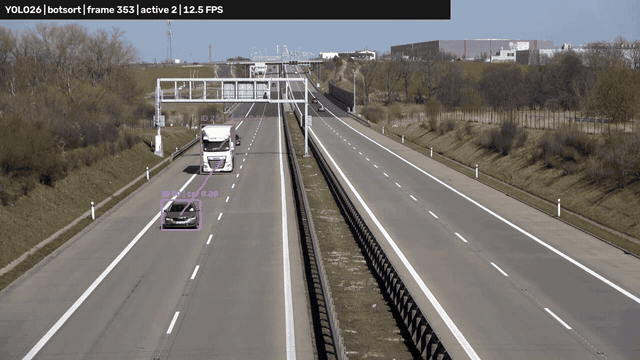
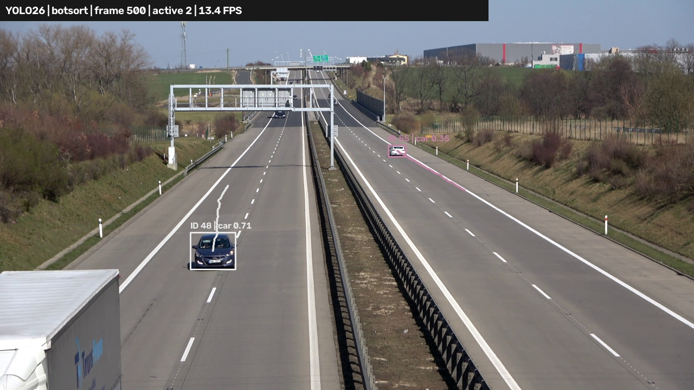
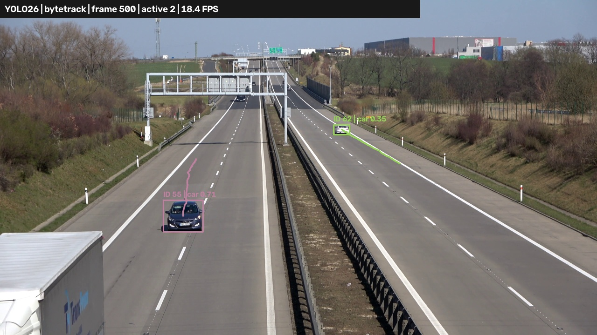
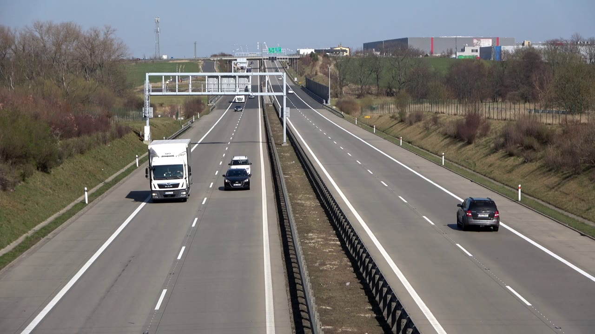
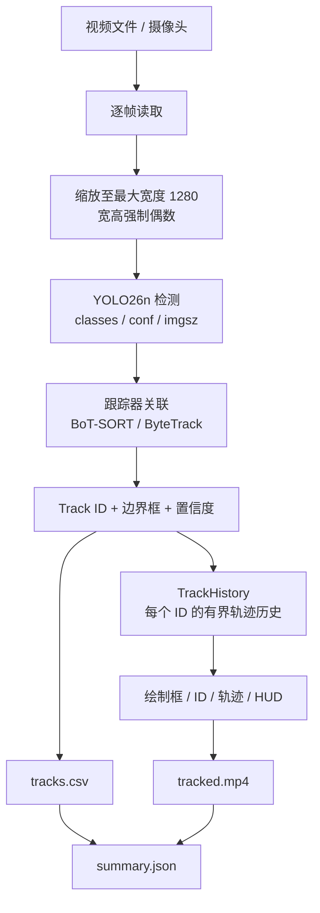

# YOLO26 车辆多目标跟踪（BoT-SORT / ByteTrack）

<p align="center">
  
</p>

<p align="center">
  
  
  
  
  
</p>

基于 Ultralytics YOLO26 与官方跟踪器的**公路车辆多目标跟踪**项目：逐帧检测车辆、为每个目标分配跨帧稳定的 Track ID、绘制运动轨迹，并输出带标注的 MP4 视频、逐帧 CSV 表格与运行摘要 JSON。

项目参考 Coding茶水间 的 YOLO26 跟踪教程实现，全部代码按 Ultralytics 官方 `model.track()` 接口独立编写，**不是教程作者的原始源码**，因此素材、参数与结果不保证与教程完全一致。

## 目录

- [1. 项目简介](#1-项目简介)
- [2. 效果预览](#2-效果预览)
- [3. 功能特性](#3-功能特性)
- [4. 环境要求](#4-环境要求)
- [5. 快速开始](#5-快速开始)
- [6. 使用示例](#6-使用示例)
- [7. 命令行参数](#7-命令行参数)
- [8. 输出文件说明](#8-输出文件说明)
- [9. 工作原理](#9-工作原理)
- [10. 跟踪器对比与性能](#10-跟踪器对比与性能)
- [11. 调参指南](#11-调参指南)
- [12. 项目结构](#12-项目结构)
- [13. 测试](#13-测试)
- [14. 常见问题](#14-常见问题)
- [15. 已知限制与说明](#15-已知限制与说明)
- [16. 扩展方向](#16-扩展方向)
- [17. 许可证](#17-许可证)
- [18. 参考与致谢](#18-参考与致谢)

---

## 1. 项目简介

目标跟踪 = **检测**（每一帧里有什么、在哪）+ **关联**（这一帧的框和上一帧的哪个目标是同一个）。YOLO26 负责检测，Ultralytics 内置的 BoT-SORT / ByteTrack 跟踪器负责跨帧关联，于是同一个目标在整段视频里拥有同一个 `track_id`。

本项目把这条流水线做成一个可直接运行的命令行工具：

- 输入：本地视频文件、网络摄像头（`--source 0`）或任意 OpenCV 可解码的视频流。
- 处理：YOLO26n 检测车辆 → BoT-SORT / ByteTrack 关联 → 轨迹历史维护 → 画面叠加。
- 输出：标注视频 `tracked.mp4`、逐帧表格 `tracks.csv`、运行摘要 `summary.json`、效果截图 `preview.jpg`。

样例使用公开的德国高速公路视频（3840×2160，25 FPS，538 帧，约 21.5 秒）与官方预训练权重 `yolo26n.pt`，**无需自行训练**。

## 2. 效果预览

**BoT-SORT**（默认跟踪器）：

<p align="center">
  
</p>

**ByteTrack**：

<p align="center">
  
</p>

截图出自 `outputs/botsort/preview.jpg` 与 `outputs/bytetrack/preview.jpg`（`outputs/` 为运行产物，不提交到仓库）。每辆车上方显示 `ID | 类别 置信度`，车后是运动轨迹，顶部 HUD 显示跟踪器、帧号、当前活跃目标数与实测处理速度。

**输入样例**（`data/vehicles.mp4` 第一帧）：

<p align="center">
  
</p>

## 3. 功能特性

- **开箱即用的 CLI**：一条命令完成检测 + 跟踪 + 可视化 + 落盘。
- **两种跟踪器自由切换**：内置 `botsort.yaml` / `bytetrack.yaml`，也可通过 `--tracker` 指向自定义 YAML。
- **跨帧 Track ID**：`persist=True` 逐帧维护跟踪状态，ID 稳定地跟随目标。
- **运动轨迹绘制**：`TrackHistory` 为每个 ID 保留最近 N 个中心点，用 `cv2.polylines` 画出尾迹。
- **有界内存**：轨迹长度与"失踪保留帧数"都可配置，空帧也会清理过期轨迹，长视频不会无限增长。
- **结构化输出**：逐帧 CSV（帧号、时间、ID、类别、置信度、框坐标）+ 机器可读的 `summary.json`。
- **输入尺寸控制**：默认把输出限制在最大宽度 1280（自动保持宽高比、强制偶数尺寸），兼顾速度与可读性；`--width 0` 保留原始分辨率。
- **参数校验**：非法的阈值 / 分辨率 / 帧数直接报错；输入文件不存在时**不会**创建输出目录；已存在的输出目录会被拒绝，避免误覆盖。
- **可测试**：5 个单元/集成测试，覆盖轨迹生命周期、CLI 参数校验、空视频真实推理与文件输出。

## 4. 环境要求

| 项目 | 要求 | 本项目验证环境 |
| --- | --- | --- |
| Python | 3.10+（推荐 3.12） | 3.12.11 |
| 操作系统 | Windows / Linux / macOS | Windows 11（10.0.22631） |
| 依赖 | `requirements.txt` | ultralytics 8.4.189、lap 0.5.13、opencv-python 5.0.0.93 |
| 深度学习框架 | PyTorch（CPU 或 CUDA 版） | torch 2.14.1+cpu、torchvision 0.29.1 |
| 硬件 | 任意 x86_64 / Apple Silicon；有 GPU 更快 | Intel i9-14900HX + RTX 4060 Laptop（**CUDA 未启用，仅 CPU**） |
| 桌面环境 | 仅 `--show` 实时窗口需要 | Windows 桌面会话 |

> 项目未提交模型权重和样例视频（`.gitignore` 已排除），克隆后体积很小，需要按第 5 节自行下载。

## 5. 快速开始

### 5.1 克隆并安装依赖

```powershell
git clone https://github.com/jinhaozheng-kk/yolo26-vehicle-tracking.git
cd yolo26-vehicle-tracking

# 方式 A：uv（更快，推荐）
uv venv .venv --python 3.12
uv pip install --python .venv/Scripts/python.exe -r requirements.txt

# 方式 B：标准 venv + pip
python -m venv .venv
.\.venv\Scripts\python.exe -m pip install -U pip
.\.venv\Scripts\python.exe -m pip install -r requirements.txt
```

- `requirements.txt` 只锁定三个直接依赖（ultralytics / lap / opencv-python），适合快速安装。
- `requirements-lock.txt` 是本机 CPU 环境导出的完整版本清单（含 torch、numpy 等），需要严格复现时可改用：
  ```powershell
  .\.venv\Scripts\python.exe -m pip install -r requirements-lock.txt
  ```

### 5.2 下载模型与样例视频

```powershell
New-Item -ItemType Directory -Force data | Out-Null

# 官方 YOLO26n 权重（约 5.5 MB）
curl.exe -L --fail -o yolo26n.pt https://huggingface.co/Ultralytics/YOLO26/resolve/main/yolo26n.pt

# 公开车辆视频（约 35 MB，3840x2160 / 25 FPS / 538 帧）
curl.exe -L --fail -o data/vehicles.mp4 https://media.roboflow.com/supervision/video-examples/vehicles.mp4
```

Linux / macOS 把 `curl.exe` 换成 `curl` 即可。下载后可用第 18 节的 SHA256 校验完整性。

### 5.3 运行

```powershell
# 默认 BoT-SORT：弹出实时窗口，结果写入新的时间戳目录
.\.venv\Scripts\python.exe track.py --show

# Windows 也可以直接双击 run_demo.cmd（等价于 track.py --show，可追加参数）
```

窗口中按 **Q** 或 **Esc** 结束。每次运行都会在 `outputs/` 下新建 `YYYYmmdd-HHMMSS-ffffff` 目录，不会覆盖旧结果。

## 6. 使用示例

| 场景 | 命令 |
| --- | --- |
| 默认 BoT-SORT，实时窗口 | `python track.py --show` |
| 切换 ByteTrack | `python track.py --tracker bytetrack.yaml --show` |
| 使用仓库内带注释的配置 | `python track.py --tracker configs/botsort.yaml --show` |
| 换成自己的视频 | `python track.py --source "D:\Videos\traffic.mp4" --show` |
| 摄像头（0 = 内置，1 = 外接） | `python track.py --source 0 --all-classes --show` |
| 只跟踪人（COCO 类别 0） | `python track.py --source "D:\Videos\people.mp4" --classes 0 --show` |
| 跟踪自行车 / 人 / 汽车 | `python track.py --classes 0 1 2` |
| 指定输出目录（必须不存在） | `python track.py --output results/run-01` |
| 只跑前 200 帧（快速验证） | `python track.py --max-frames 200` |
| 更长尾迹 + 更高推理分辨率 | `python track.py --trail-length 100 --imgsz 960 --show` |
| 保留原始输出分辨率 | `python track.py --width 0` |
| 无窗口批处理（服务器/CI） | `python track.py --source data/vehicles.mp4` |

> 上面命令均省略了 `.\.venv\Scripts\` 前缀；在已激活虚拟环境的终端里可直接用 `python track.py`。路径含空格时请加引号。

## 7. 命令行参数

全部参数及默认值（`python track.py -h` 也可查看）：

| 参数 | 默认值 | 说明 |
| --- | --- | --- |
| `--source` | `data/vehicles.mp4` | 视频文件路径或摄像头索引（纯数字，如 `0`）。不存在时会直接报错 |
| `--model` | `yolo26n.pt` | YOLO 权重路径。Ultralytics 会自动识别模型结构 |
| `--tracker` | `botsort.yaml` | 跟踪器：内置名（`botsort.yaml` / `bytetrack.yaml`）或自定义 YAML 路径 |
| `--output` | `outputs/<时间戳>` | 输出目录；**目录必须尚不存在**，否则报错退出 |
| `--device` | `auto` | `auto`（有 CUDA 用 GPU 0，否则 CPU）、`cpu` 或 GPU 序号 `0` |
| `--classes` | `2 3 5 7` | COCO 类别 ID 列表：car / motorcycle / bus / truck |
| `--all-classes` | 关闭 | 跟踪全部 80 个 COCO 类别，覆盖 `--classes` |
| `--conf` | `0.1` | 检测置信度阈值。默认较低，为跟踪器第二阶段保留低分框 |
| `--imgsz` | `640` | 推理分辨率（最小 32）。越大越准也越慢 |
| `--width` | `1280` | 输出视频最大宽度；`0` 表示保持原分辨率。高度按比例缩放并强制为偶数 |
| `--trail-length` | `60` | 每个 ID 最多保留并绘制多少个历史中心点 |
| `--max-age` | `30` | 轨迹绘制历史在目标消失多少帧后清理（**不是**跟踪器的 `track_buffer`） |
| `--max-frames` | `0` | 最多处理多少帧；`0` 表示整段视频 |
| `--show` | 关闭 | 弹出实时窗口，按 Q / Esc 提前结束 |

参数校验规则：`0 ≤ conf ≤ 1`、`imgsz ≥ 32`、`max-frames ≥ 0`、`width` 为 `0` 或 `≥ 2`、`trail-length ≥ 1`、`max-age ≥ 0`；不满足时 argparse 直接报错退出（退出码 2）。

常用 COCO 类别 ID：`0` person、`1` bicycle、`2` car、`3` motorcycle、`5` bus、`7` truck。

## 8. 输出文件说明

每次运行生成一个独立目录：

```text
outputs/
└─ 20261026-143757-689948/
   ├─ tracked.mp4    # 叠加了框、ID、轨迹和 HUD 的视频
   ├─ tracks.csv     # 逐帧目标级数据
   ├─ summary.json   # 运行摘要（帧数、速度、设备、参数、版本）
   └─ preview.jpg    # 效果截图
```

### 8.1 `tracked.mp4`

- 使用 OpenCV 的 `mp4v` 编码，**不保留源音频**；部分浏览器无法直接播放，建议用 VLC / MPV / 系统播放器。
- 帧率沿用源视频（读不到时回退 30 FPS），分辨率受 `--width` 限制，宽高均为偶数。
- 画面元素：彩色框（颜色由 ID 哈希生成）、`ID | 类别 置信度` 标签、目标轨迹线、顶部 HUD（跟踪器、帧号、活跃目标数、累计平均 FPS）。

### 8.2 `tracks.csv`

每行 = 某一帧里的一个已确认跟踪目标，UTF-8 编码：

| 列 | 示例 | 说明 |
| --- | --- | --- |
| `frame` | `1` | 帧号，从 **1** 开始 |
| `time_seconds` | `0.0` | 时间戳，`(frame - 1) / fps`，从 0 开始 |
| `track_id` | `1` | 本次运行内唯一的跟踪 ID |
| `class_id` | `2` | COCO 类别 ID |
| `class_name` | `car` | 类别名称 |
| `confidence` | `0.81278` | 检测置信度（保留 5 位小数） |
| `x1`, `y1`, `x2`, `y2` | `978.05, 423.06, 1075.68, 499.47` | 左上 / 右下角坐标，单位为**输出视频像素** |

```csv
frame,time_seconds,track_id,class_id,class_name,confidence,x1,y1,x2,y2
1,0.0,1,2,car,0.81278,978.05,423.06,1075.68,499.47
1,0.0,2,2,car,0.52578,477.85,355.33,540.99,410.29
1,0.0,3,7,truck,0.48373,314.83,300.6,412.36,435.31
```

### 8.3 `summary.json`

样例（CPU 跑完 538 帧的真实结果）：

```json
{
  "source": "data/vehicles.mp4",
  "model": "yolo26n.pt",
  "tracker": "botsort.yaml",
  "device": "cpu",
  "frames": 538,
  "source_fps": 25.0,
  "width": 1280,
  "height": 720,
  "unique_track_ids": 19,
  "elapsed_seconds": 33.854,
  "processing_fps": 15.89,
  "stopped_early": false,
  "classes": [2, 3, 5, 7],
  "conf": 0.1,
  "imgsz": 640,
  "ultralytics": "8.4.189",
  "torch": "2.14.1+cpu"
}
```

| 字段 | 说明 |
| --- | --- |
| `frames` | 实际处理帧数（含被 `--max-frames` / Q 截断的帧） |
| `unique_track_ids` | 本次运行**出现过的** ID 总数，不等于真实车辆数 |
| `elapsed_seconds` | 从读取首帧到处理结束的墙钟时间，含推理、绘图与编码，**不含**模型加载 |
| `processing_fps` | `frames / elapsed_seconds`，累计平均速度 |
| `stopped_early` | 是否因 Q / Esc / `--max-frames` 提前结束 |

> 说明：`elapsed_seconds` 从第一帧读入后开始计时，包含逐帧推理、绘制与视频编码时间，但不包含 import、模型加载与首帧解码开销；因此它略高于"纯推理速度"的直觉值。

### 8.4 `preview.jpg`

在第 1 帧以及每 100 帧时刷新，写入最后一张，用于快速预览效果。

### 8.5 程序行为与退出码

- 参数非法 → argparse 报错，退出码 **2**。
- 输入无法打开 / 无法解码 / 无法创建视频写入器 → 打印 `Error: ...`，退出码 **1**，且不会留下半成品输出目录。
- 输出目录已存在 → 报错退出（防止覆盖），退出码 **2**。
- 正常结束（含 Q / Esc 提前结束）→ 退出码 **0**，仍会写 `summary.json`。

## 9. 工作原理



对应代码：

| 步骤 | 位置 |
| --- | --- |
| 参数解析与校验 | `track.py` → `parse_args()` |
| 设备选择、加载模型、打开视频 | `track.py` → `run()` 开头 |
| 逐帧推理 + 关联 | `model.track(frame, persist=True, tracker=..., conf=..., imgsz=...)` |
| 读取 ID / 类别 / 置信度 / 框 | `result.boxes.id / .cls / .conf / .xyxy` |
| 轨迹历史与过期清理 | `tracking.py` → `TrackHistory.update()` |
| 绘制框、标签、轨迹、HUD | `cv2.rectangle` / `cv2.putText` / `cv2.polylines` |
| 写 CSV / 视频 / 摘要 | `csv.writer` / `cv2.VideoWriter` / `summary.json` |

几个关键设计：

1. **`persist=True` 是跟踪的核心**。它让跟踪器在连续帧之间保留状态，因此必须按顺序逐帧调用；一旦换视频或重跑，应视为一次全新的跟踪会话，ID 从新开始。
2. **检测阈值刻意压低**。`--conf` 默认 0.1，低于跟踪器的 `track_high_thresh`（0.25）：高分框走第一阶段匹配，低分框留给第二阶段二次匹配，能改善遮挡/模糊时的连续性。若只做检测，这个值通常偏低。
3. **轨迹历史与跟踪器状态是两回事**。`TrackHistory` 只服务于"画线"：每个 ID 存一个 `deque(maxlen=trail_length)` 的中心点队列，超过 `max_age` 帧没出现就删除；跟踪器内部的 `track_buffer` 才决定 ID 能"复活"多久。二者独立配置。
4. **逐帧读取 + 有界历史**。视频不会一次性读入内存，轨迹历史也有上限，因此长视频的内存占用基本恒定。
5. **输出尺寸先定、坐标后算**。所有框坐标都基于最终输出分辨率（不是源视频），CSV 与画面一致。
6. **偶数尺寸**。MP4 编码器要求宽高为偶数，因此缩放后统一向下取整到偶数。

## 10. 跟踪器对比与性能

两种跟踪器都由 Ultralytics 内置实现，本项目的 `configs/` 只是带中文注释的配置副本（保留上游 AGPL-3.0 头部）。

| 维度 | BoT-SORT | ByteTrack |
| --- | --- | --- |
| 关联方式 | IoU + 相机运动补偿（GMC）+ 可选 ReID | 两阶段 IoU 关联：高分框先匹配，低分框补匹配 |
| 相机运动补偿 | 支持（`sparseOptFlow` / `orb` / `sift` / `ecc` / `none`） | 不支持 |
| 外观特征 | 可选 ReID（`with_reid: true`） | 无 |
| 额外开销 | 更高（GMC，开启 ReID 后更高） | 更低 |
| 典型场景 | 相机移动、遮挡多、需要更稳的 ID | 固定机位、追求速度 |

**同机实测**（Windows 11，i9-14900HX，CPU，源码 3840×2160 → 输出 1280×720，`imgsz=640`，538 帧全片）：

| 跟踪器 | 处理帧数 | 总耗时 | 平均 FPS | 出现过的唯一 ID 数 |
| --- | ---: | ---: | ---: | ---: |
| BoT-SORT | 538 | 33.85 s | 15.89 | 19 |
| ByteTrack | 538 | 30.94 s | 17.39 | 19 |

几点解读：

- 样例视频 25 FPS，纯 CPU 下约 16–17 FPS，**慢于实时**；首次运行还包含前端预热（首帧推理明显偏慢），重复运行数字会小幅波动。
- ByteTrack 在本例中约快 9%，因为省掉了 GMC 光流计算；两者唯一 ID 数相同只是巧合，不能作为精度结论。
- 本项目**没有做**带标注的 MOT 指标评测（MOTA / IDF1 / HOTA），上表只反映速度，不反映跟踪精度。
- 右侧车道的远处小车、遮挡和出画仍可能漏检或换 ID，这是公开预训练模型 + 默认参数的正常表现。

### GPU 加速

当前环境装的是 CPU 版 PyTorch（`torch 2.14.1+cpu`），RTX 4060 Laptop **尚未启用 CUDA**。要启用：

```powershell
# 按 https://pytorch.org/get-started/locally/ 选择适配 Windows / pip / CUDA 的命令，安装到本项目 .venv
.\.venv\Scripts\python.exe -c "import torch; print(torch.cuda.is_available())"   # 期望 True
.\.venv\Scripts\python.exe track.py --device 0 --show
```

`--device auto` 检测到 CUDA 后会自动选 `0`；没有 GPU 时用 `--device cpu` 强制 CPU。

## 11. 调参指南

### 11.1 跟踪器参数（`configs/*.yaml`）

| 参数 | 默认 | 作用与调整方向 |
| --- | ---: | --- |
| `track_high_thresh` | 0.25 | 第一阶段匹配的检测分数下限。调高更干净，调低保留更多 |
| `track_low_thresh` | 0.1 | 第二阶段低分检测的下限，用于找回漏检 |
| `new_track_thresh` | 0.25 | 创建新轨迹所需分数。调高减少虚假轨迹，调低更容易接上新目标 |
| `track_buffer` | 30 | 丢失目标保留帧数。调大更耐遮挡，但 ID 切换风险也变化 |
| `match_thresh` | 0.8 | 关联相似度阈值，需结合检测质量和场景调 |
| `fuse_score` | True | 将检测分数融合进匹配代价，稳定弱检测 |
| `gmc_method`（仅 BoT-SORT） | `sparseOptFlow` | 相机运动补偿方法；静态机位可设 `none` 略提速 |
| `proximity_thresh` | 0.5 | 进入 ReID 匹配的最小 IoU，越高越严格 |
| `appearance_thresh` | 0.8 | 外观相似度阈值，调高减少错误合并 |
| `with_reid` | False | 是否启用 ReID；需要额外模型与算力 |
| `model` | `auto` | ReID 模型；`auto` 在有检测特征时使用检测器特征 |

修改后通过 `--tracker configs/botsort.yaml` 使用；**直接改 `configs/` 不会影响内置跟踪器**，必须显式指定路径。

### 11.2 常用调参配方

| 目标 | 调整 |
| --- | --- |
| 远处小车漏检多 | `--conf 0.05~0.08`、`--imgsz 960`；确认 `--classes` 包含目标类别 |
| 误检/虚假轨迹多 | `--conf 0.2~0.3`、`new_track_thresh` 0.25→0.4、`track_high_thresh` ↑ |
| 遮挡后频繁换 ID | `track_buffer` 30→60~90；BoT-SORT 可试 `with_reid: true`、`appearance_thresh` ↑ |
| 镜头移动/抖动 | BoT-SORT 保持 `gmc_method: sparseOptFlow`；静态机位可设 `none` 提速 |
| 速度优先 | 改用 `bytetrack.yaml`、`--imgsz 480/640`、`--width 960`、`--trail-length 30` |
| 轨迹太短/太长 | `--trail-length` 与 `--max-age` 只影响**绘制**，不影响跟踪结果 |

### 11.3 检测参数

| 参数 | 影响 |
| --- | --- |
| `--conf` | 检测下限。跟踪场景建议低于 0.25，让跟踪器拿到低分框 |
| `--imgsz` | 推理分辨率。640 是速度/精度平衡点；960~1280 提升小目标，代价明显 |
| `--classes` | 限定类别可显著减少干扰与后处理；`--all-classes` 跟踪全部 |
| `--width` | 只影响输出视频分辨率与画质，不改变推理尺寸 |

## 12. 项目结构

```text
yolo26-vehicle-tracking/
├─ track.py                # 主程序：参数、推理、绘制、CSV/视频/摘要输出
├─ tracking.py            # TrackHistory：有界轨迹历史与过期清理
├─ configs/
│  ├─ botsort.yaml         # BoT-SORT 参数（上游默认值 + 中文注释）
│  └─ bytetrack.yaml       # ByteTrack 参数（上游默认值 + 中文注释）
├─ tests/
│  ├─ test_cli.py          # CLI 参数校验、空视频端到端、输出目录保护
│  └─ test_tracking.py     # 轨迹长度、ID 隔离、空帧过期、非法参数
├─ assets/                 # README 用截图与演示 GIF
├─ data/                   # 样例视频下载目录（*.mp4 不提交）
├─ outputs/                # 运行结果（不提交）
├─ run_demo.cmd            # Windows 一键演示脚本
├─ requirements.txt        # 直接依赖
├─ requirements-lock.txt   # 本机 CPU 环境完整版本锁
├─ yolo26n.pt              # 模型权重（不提交，需自行下载）
├─ LICENSE                 # MIT
└─ README.md
```

## 13. 测试

```powershell
.\.venv\Scripts\python.exe -m unittest discover -s tests -v
```

预期输出：

```text
Ran 5 tests in 3.845s

OK
```

| 测试 | 覆盖内容 |
| --- | --- |
| `test_limits_trail_length_without_mixing_ids` | 轨迹长度上限生效，不同 ID 互不串线 |
| `test_expires_lost_tracks_even_on_empty_frames` | 空帧也会清理过期轨迹；ID 复用时历史重新开始 |
| `test_rejects_invalid_limits` | `TrackHistory` 拒绝非法长度/过期参数 |
| `test_missing_input_does_not_create_output` | 输入不存在时非零退出且**不创建**输出目录 |
| `test_blank_video_is_saved_without_fake_tracks` | 真实跑一次推理：空视频输出 4 帧、CSV 为空、无虚假 ID；重复使用同一输出目录会被拒绝 |

说明：

- `test_blank_video_is_saved_without_fake_tracks` 是集成测试，需要根目录存在 `yolo26n.pt` 并实际加载模型推理（测试视频为 320×240 的 4 帧黑屏，CPU 上约 4 秒）；`test_missing_input_does_not_create_output` 只验证参数校验，不会加载模型。
- 测试全部在临时目录运行，不会污染 `outputs/`。
- 测试视频由测试代码用 OpenCV 现场生成，不依赖网络。

## 14. 常见问题

**Q：双击 `run_demo.cmd` 闪退？**
A：脚本只在 `.venv\Scripts\python.exe` 存在时启动。先按第 5 节建好虚拟环境；或在终端里直接运行命令查看真实报错。

**Q：`--show` 没有窗口 / 报 GUI 相关错误？**
A：`cv2.imshow` 需要桌面会话。服务器、WSL、SSH 无图形界面时去掉 `--show`，程序会直接输出视频；确需 GUI 时确保安装的是普通 `opencv-python`（而非 `opencv-python-headless`）。

**Q：输出的 MP4 在浏览器里打不开，也没有声音？**
A：`mp4v` 编码兼容性一般且不写入音频轨。用本地播放器打开；需要 H.264 可转码：
```powershell
ffmpeg -i outputs\<run>\tracked.mp4 -c:v libx264 -pix_fmt yuv420p -crf 20 tracked_h264.mp4
```

**Q：路径里有中文/空格时报错？**
A：OpenCV 在 Windows 对非 ASCII 路径支持不稳定。请把视频和模型放到英文路径，路径含空格时用引号包起来。

**Q：模型下载失败或太慢？**
A：手动下载 `yolo26n.pt` 放到项目根目录即可（见 5.2）。离线环境还可以先下载到其他机器再拷贝，并用 SHA256 校验。

**Q：摄像头打不开？**
A：先试 `--source 0`，外接摄像头试 `--source 1`；关闭其他占用摄像头的程序。USB 摄像头首次打开可能较慢。

**Q：报错 `Output already exists`？**
A：这是防覆盖保护。删除旧目录或换一个新的 `--output`；不传 `--output` 时会自动生成带时间戳的新目录。

**Q：怎么用 GPU？**
A：安装 CUDA 版 PyTorch（见第 10 节 GPU 部分），确认 `torch.cuda.is_available()` 为 `True`，然后 `--device auto` 或 `--device 0`。

**Q：为什么同一个 Track ID 会变，或者 ID 数比车多？**
A：遮挡、漏检、出画后重新进入都会被跟踪器当作新目标；远处小目标尤其明显。可尝试 `track_buffer` ↑、`--imgsz` ↑、BoT-SORT + ReID。`unique_track_ids` 只是"出现过的 ID 数"，不是车辆计数。

**Q：想跟踪行人怎么办？**
A：`--classes 0`；行人和车辆一起跟踪用 `--classes 0 2 3 5 7`；全部类别用 `--all-classes`。

## 15. 已知限制与说明

- 未做带标注的跟踪精度评测（MOTA / IDF1 / HOTA），项目内的参数结论基于样例视频的定性观察。
- `unique_track_ids` 不能直接当作真实车辆总数；轨迹在遮挡、漏检、出画后可能断裂并产生新 ID。
- 默认 CPU 推理速度约 16–17 FPS，低于 25 FPS 源视频，因此实时窗口会"慢放"；性能数据受机器影响很大。
- 输出视频使用 `mp4v` 编码且无音频；默认最大宽度 1280，框坐标以输出分辨率为准。
- `--width` 只改变输出画质，不改变推理分辨率；想提升小目标检测应调 `--imgsz`。
- 依赖 Ultralytics 内置跟踪器实现；暂不支持 DeepSORT、OC-SORT 等其他后端（可通过自定义 YAML 扩展，但受上游支持范围限制）。
- 默认关闭 ReID；开启后速度会下降，且需要额外权重。
- 只处理单路视频，未实现多路、RTSP 重连、断点续跑与模型导出。
- Windows 下非 ASCII 路径的视频读写兼容性未做特殊处理。
- 轨迹历史内存有界，但 `tracks.csv` 与 `summary.json` 会随视频长度线性增长。

## 16. 扩展方向

- **交通指标**：越线计数、车流量统计、平均车速估计（需要相机标定与透视变换）。
- **更稳的身份**：开启 `with_reid: true`，在遮挡/交叉场景减少 ID 切换。
- **精度评测**：在 MOT17 / BDD100K 等带标注数据集上评估 MOTA / IDF1 / HOTA，量化调参收益。
- **交付形态**：导出 H.264，或做 Web 端实时预览；用 [Supervision](https://github.com/roboflow/supervision) 替换手写可视化。
- **部署加速**：ONNX / TensorRT / OpenVINO 导出，路侧设备实时推理。
- **多路与流式**：多摄像头并行、RTSP 断流重连、结果入库。

## 17. 许可证

- 本仓库中**原创代码**（`track.py`、`tracking.py`、`tests/` 等）采用 [MIT License](LICENSE)。
- `configs/botsort.yaml`、`configs/bytetrack.yaml` 保留上游 **AGPL-3.0** 许可头，其使用遵循 [Ultralytics 许可](https://github.com/ultralytics/ultralytics/blob/main/LICENSE)。
- `ultralytics` 依赖、YOLO26 模型权重均为 **AGPL-3.0**；将本项目用于商业用途前，请自行确认上游许可要求。
- 样例视频来自 Roboflow Supervision 公开示例素材，版权归原素材方，本项目仅用于学习与演示。

## 18. 参考与致谢

- [原教程：Coding茶水间 YOLO26 跟踪](https://www.douyin.com/video/7668149296797158671)
- [Ultralytics 跟踪模式文档](https://docs.ultralytics.com/modes/track/)
- [YOLO26 官方文档](https://docs.ultralytics.com/models/yolo26/)
- [官方 YOLO26 模型仓库（Hugging Face）](https://huggingface.co/Ultralytics/YOLO26)
- [Roboflow Supervision 公开车辆视频](https://media.roboflow.com/supervision/video-examples/vehicles.mp4)
- [PyTorch 官方安装页](https://pytorch.org/get-started/locally/)

**下载文件 SHA256 校验**（`Get-FileHash <文件> -Algorithm SHA256`）：

```text
yolo26n.pt        9b09cc8bf347f0fc8a5f7657480587f25db09b34bf33b0652110fb03a8ad4fef
data/vehicles.mp4 ac81100d9310bd4e9c02bc0b13b6492781d009742ced347766b2601be3c44ad4
```

如果这个项目对你有帮助，欢迎点个 ⭐ Star。
